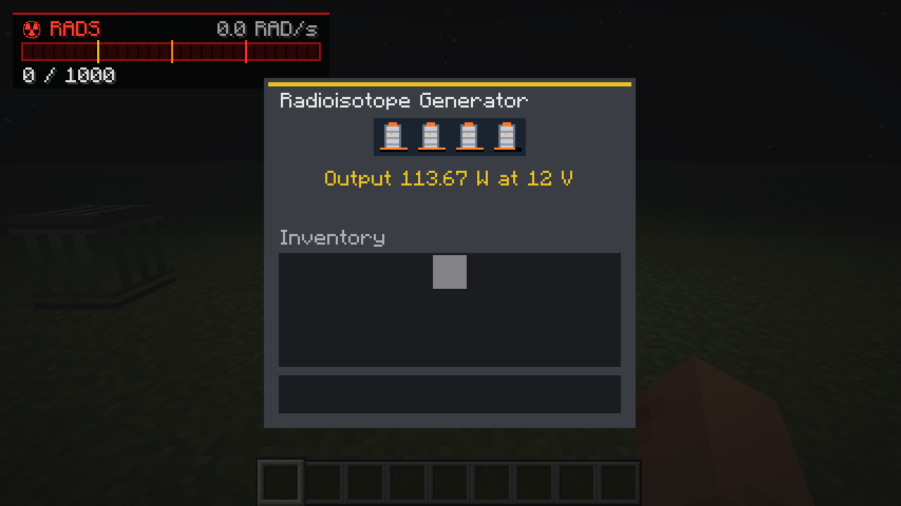
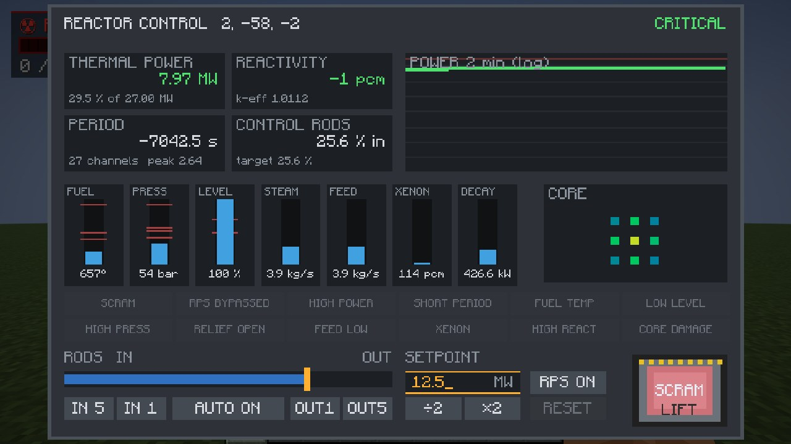
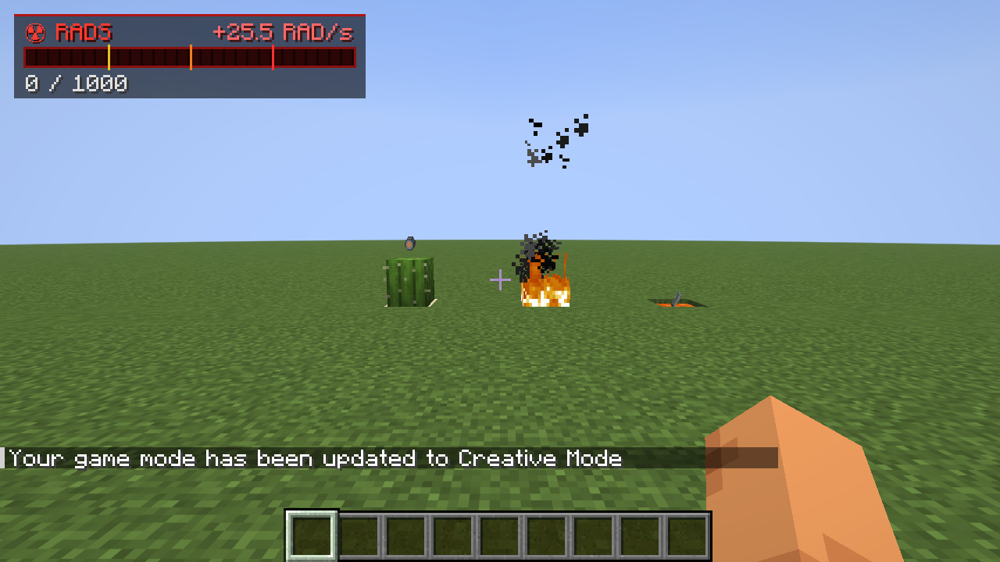
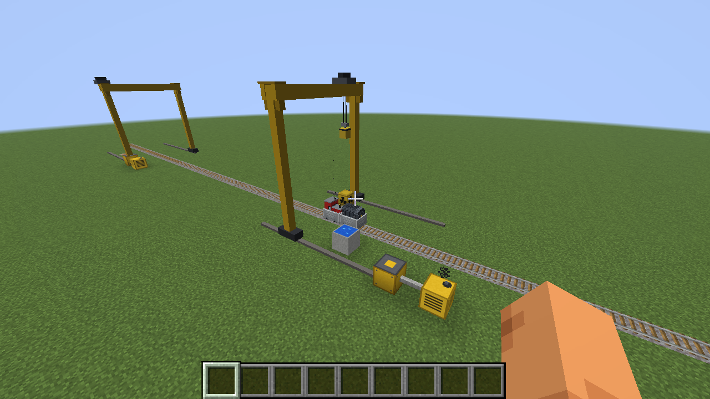
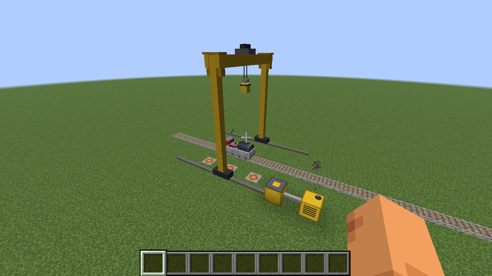
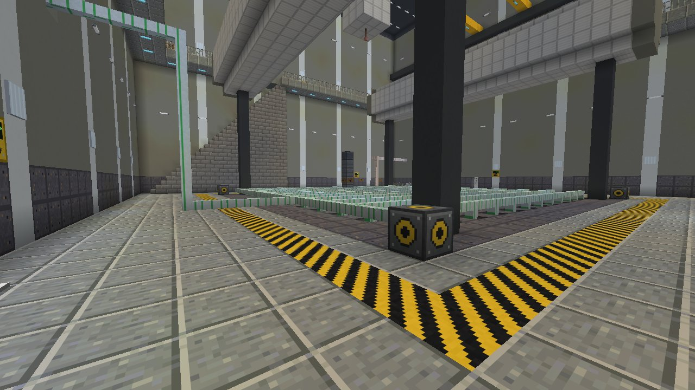
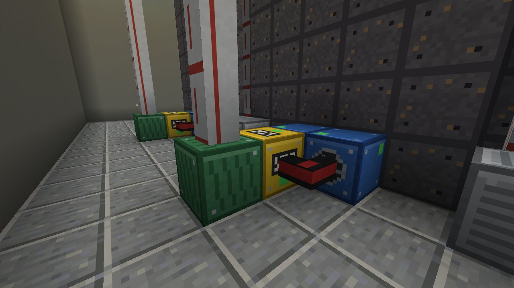

# Fission

Kernreaktoren für **Minecraft 26.3** (Fabric). Baue einen Kern aus Brennelementkanälen, Graphit, Beryllium-Reflektoren
und Steuerstäben. Füll ihn mit Wasser, zieh die Stäbe, und die Kettenreaktion setzt ein: verzögerte Neutronen,
Doppler-Rückkopplung, Xenon, Nachzerfallswärme. Dampf treibt Turbinen an, deren Generatoren ins **Gridworks**-Netz
einspeisen. Ein Leitstand mit SCRAM-Taster, Meldetableaus und Kernkarte hält alles im Griff. Abgebrannter Brennstoff
steckt voller echter Spaltprodukte mit echten Halbwertszeiten, die in Abklingbecken und Lagerfässer wandern. Fällt die
Kühlung aus, schmilzt der Kern zu Corium; wird er prompt kritisch, fliegt das Dach weg und brennender Graphit und
Brennstoff regnen weit über das Land, es sei denn, das Dach ist aus dickem Beton; danach zieht eine radioaktive Wolke
mit dem Wind und hinterlässt Fallout. Alle Strahlung läuft über die **Radiation**-Mod.

Online-Handbuch: https://mchamradio.antwire.net/handbook/fission/
Quellcode: [github.com/Lamisator/fission](https://github.com/Lamisator/fission)


## Installation

Fission braucht **Fabric API**, **Gridworks 1.1.2** oder neuer und **Radiation 1.10.0** oder neuer.

1. Leg im Prism Launcher eine Minecraft-**26.3**-Instanz mit **Fabric** an (Loader 0.19.5 oder neuer).
2. **Edit → Mods → Download mods**: installiere **Fabric API**.
3. **Add file**: `gridworks-1.1.2.jar`, `radiation-1.10.0.jar` und `fission-1.5.1.jar`.

Für einen Server kommen dieselben JARs in dessen `mods`-Ordner. Jeder Spieler braucht sie ebenfalls.

## Vom Erz zum Brennstoff

| Schritt | Wie |
|---|---|
| Uranerz | Tief unter der Erde, unter Y 16 (Stein und Tiefenschiefer). Lässt Rohuran fallen. |
| Yellowcake | Rohuran schmelzen (Natururanoxid, 0,7 % U-235). |
| Angereichertes Uran | **Gaszentrifuge** (230 V, 2 kW aus Gridworks): 4 Yellowcake → 1 angereichertes (3,5 %) + 3 abgereichertes Uran, 20 s. |
| Zircaloy-Hüllrohr | 2 Eisen + 1 Quarz → 4. |
| Brennelemente | 3 Yellowcake (Natururan), 3 angereichertes Uran (LEU) oder 1 Plutonium + 2 abgereichertes Uran (MOX), jeweils mit 6 Hüllrohren. |
| Graphit | Kohleblöcke im Schmelzofen. |
| Beryllium | Smaragde sind Beryll: 4 Smaragde + 5 Eisen → 4 Reflektoren. |

| Brennstoff | U-235 / Pu-239 | Lebensdauer | Hinweise |
|---|---|---|---|
| Natururan | 0,7 % | 4 MWd | Wird nur in einem großen, gut moderierten Graphitblock kritisch (5×5×5 Kanäle oder mehr). |
| LEU | 3,5 % | 15 MWd | Der Standardbrennstoff; auch kleine Kerne werden kritisch. |
| MOX | 6 % Pu | 12 MWd | Aus Plutonium, das bei der Wiederaufarbeitung zurückgewonnen wurde. |

## Einen Reaktor bauen

Ein Reaktor ist ein zusammenhängender Klumpen aus Kernblöcken. Die **Reaktorsteuerung**, die daran gesetzt wird, findet
jeden verbundenen Block:

- **Brennelementkanal**: nimmt ein Brennelement auf; nominell je 1 MW thermisch. Leuchtet blau, wenn darin Spaltungen
  ablaufen.
- **Steuerstab**: Borcarbid-Absorber; die Steuerung fährt alle gemeinsam.
- **Graphit-Moderator**: bremst Neutronen ab, ohne sie zu absorbieren. Gehört zwischen die Kanäle.
- **Beryllium-Reflektor**: schickt entweichende Neutronen zurück. Umhülle den Kern damit.
- **Reaktordruckbehälter**: schlichte Stahlwand.
- **Speisewasserstutzen**, **Frischdampfstutzen**, **Sicherheitsventil**: Behälterblöcke mit Stutzen.

Die Neutronenbilanz wird Block für Block berechnet. Neutronen verlassen einen Brennelementkanal durch seine sechs
Seiten. Graphit und Beryllium streuen sie zurück (und bremsen sie ab); Wasser in den Kanälen bremst sie ein wenig und
absorbiert einige; Steuerstäbe absorbieren sie; alles andere lässt sie entweichen. Langsame Neutronen, die Brennstoff
erreichen, lösen weit mehr Spaltungen aus als schnelle. Die Anordnung zählt also, wie in einem echten Kern:

- Ein einzelner Kanal ist weit von der Kritikalität entfernt (k ≈ 0,1). Kanäle müssen sich Neutronen teilen.
- Graphit zwischen den Kanälen (jeder zweite Block) ist ein klassisches Gitter.
- Eine Reflektorhülle bringt einige Prozent.
- Stäbe zwischen Brennelementkanälen sind viel mehr wert als Stäbe am Rand.
- **Void-Koeffizient**: In einem Graphitkern macht das Verdampfen des Wassers ihn *reaktiver* (das Wasser hat vor
  allem absorbiert), wie beim RBMK. In einem Kern, der nur durch Wasser moderiert wird, wird er weniger reaktiv.

**Ein Einsteigerreaktor** (der aus den Screenshots): 3×3 Säulen aus LEU-Brennelementkanälen, 3 hoch, in jeder Richtung
jeder zweite Block (Teilung 2), dazwischen überall Graphit, acht Steuerstabsäulen in den Lücken des äußeren Rings und
ringsum eine Berylliumhülle. In dieser Hülle: ein Speisewasserstutzen unten auf einer Seite, ein Frischdampfstutzen auf
der anderen, ein Sicherheitsventil oben und die Steuerung daran. Er hat 27 MW Nennleistung; kalt ist er mit etwa 27 %
eingefahrenen Stäben kritisch (k = 1,11 mit gezogenen Stäben, 0,89 mit eingefahrenen).

```
 top view, one layer      F fuel channel   G graphite   R control rod   B beryllium
   B B B B B B B
   B F R F R F B
   B R G G G R B
   B F G F G F B
   B R G G G R B
   B F R F R F B
   B B B B B B B
```

(Draufsicht, eine Lage: F Brennelementkanal, G Graphit, R Steuerstab, B Beryllium.)

## Physik

Kerne jeder Größe funktionieren: Die Neutronenbilanz eines Kerns mit Hunderten von Kanälen (300 oder mehr) wird in einem
Hintergrund-Thread berechnet, der auch schon die Stabstellungen neben der aktuellen vorbereitet; so kostet ein
1000-MW-Kern den Server deutlich unter einer Millisekunde pro Tick. Solange ein neues Ergebnis unterwegs ist, folgt k den
Stäben entlang der Steigung des letzten. Ein Kern darf bis zu 32 768 Blöcke haben; Brennstoff wandert durch bis zu
8192 Rohre und Kanäle.

Alles, was für den Reaktorbetrieb zählt, wird simuliert:

- **Punktkinetik mit verzögerten Neutronen** (β = 0,65 %). Unterhalb der prompten Kritikalität ändert sich die
  Leistung mit einer Periode von Dutzenden Sekunden und lässt sich regeln. Darüber (Reaktivität über 650 pcm) geht sie
  in Millisekunden durch, und der Reaktor explodiert.
- **Doppler-Rückkopplung**: −2,5 pcm je °C Brennstofftemperatur. Ein heißer Kern ist weniger reaktiv.
- **Xenon-135**: baut sich unter Leistung aus Iod auf. Nach einer Abschaltung erreicht es für einige Minecraft-Stunden
  sein Maximum und kann ein Wiederanfahren eine Weile unmöglich machen (die „Xenonvergiftung“).
- **Nachzerfallswärme**: Nach einem SCRAM kommen noch etwa 6,5 % der Leistung, die über einige Minuten auf 1 % fallen und
  danach langsam weiter. Der Kern muss weiter gekühlt werden.
- **Abbrand**: Jedes Brennelement brennt ab und füllt sich mit Spaltprodukten (siehe unten).
- Eine **Anfahrneutronenquelle** hält in einem abgeschalteten Kern ein paar Watt aufrecht.

Die Kinetik läuft in Echtzeit. Langsame Vorgänge (Abbrand, Nachzerfallswärme, Xenon, Isotope) laufen in Spielzeit, in
der ein Minecraft-Tag 24 Stunden hat, wie die Energie in Gridworks.

## Dampf, Turbinen und Strom

| Block | Was er tut |
|---|---|
| **Speisewasserpumpe** | Pumpt bis zu 20 kg/s aus angrenzendem Wasser. Braucht **10 kV** aus Gridworks: etwa 9 kW je kg/s gegen 70 bar, beim Befüllen viel weniger. Bei Strommangel wird sie langsamer. Redstone hält sie an. |
| **Speisewasserleitung** (blau) | Von den Pumpen zum Speisewasserstutzen des Reaktors. 40 kg/s je Netz. |
| **Dampfleitung** (silbern) | Vom Frischdampfstutzen zu Turbinen und Kondensatoren. 40 kg/s je Netz. |
| **Dampfturbine** | Dreht mit Dampf bis auf 3000 U/min hoch, sobald der Reaktor 40 bar hat. Das Wellenende ist ihre Vorderseite. Hält 1 MW Momentanreserve, sodass ihr Generator eine neue Last innerhalb von ein, zwei Sekunden übernimmt. |
| **Turbogenerator** | Am Wellenende der Turbine: bis zu **5 MW bei 10 kV** ins Gridworks-Netz, sobald er synchronisiert ist. Setz einen Umspannwerk-Transformator direkt daran für 110 kV, oder Mittelspannungskabel. |
| **Kondensator** | Turbinenumleitung: Über 70 bar nimmt er den Dampf, den die Turbinen nicht brauchen. 20 kg/s mit angrenzendem Kühlwasser, 3 kg/s luftgekühlt. |
| **Sicherheitsventil** | Bläst über 85 bar Dampf ab (und verliert dieses Wasser). Ohne eines birst der Behälter bei 150 bar. |

Der Kern fasst 100 kg Wasser je Brennelementkanal. Es heizt sich auf, siedet (1 MW erzeugt 0,5 kg/s Dampf) und baut
Druck auf; die Turbine nimmt, was ihr Generator abgibt, 0,7 MJ Strom je kg Dampf bei 70 bar (etwa 35 %). Die Pumpen
laufen mit 10 kV, ein Kraftwerk braucht zum Anfahren also Fremdstrom und kann seine Pumpen danach aus dem eigenen
Generator versorgen.

Jedes Leitungsnetz transportiert 40 kg/s, ein großer Reaktor braucht also mehrere Ein- und Auslässe, jeder an einem
eigenen Netz (Netze, die sich berühren, werden eins): 1000 MW verdampfen 500 kg/s, das braucht mindestens 13 Speisewasser-
und 13 Dampfnetze. Eine Pumpe kann direkt an einem Turbogenerator sitzen (oder an einem kurzen Mittelspannungskabel
davon), eine Eigenbedarfsturbine an einem der Dampfnetze: Das versorgt die Pumpen, ohne über Transformatoren und das
Netz zu gehen.


### Radionuklidbatterie

Für Strom, um den man sich nie kümmern muss: Eine **Radionuklidbatterie** (RTG) wandelt die Zerfallswärme von bis zu
vier **Pu-238-Wärmequellen** in **12 V Gleichstrom** für Gridworks um, etwa **30 W je Wärmequelle** (120 W mit vier).
Sie hat keine beweglichen Teile und braucht keinen Brennstoff: Sie speist jedes Gleichstromkabel, jeden Akku und jedes
12-V-Gerät, das sie berührt, Tag und Nacht, bis das Plutonium zerfallen ist. Pu-238 hat eine Halbwertszeit von
87,7 Jahren, das sind in Spielzeit etwa **445 echte Tage bis zur halben Leistung** (und weitere 445 bis zu einem
Viertel). Eine Wärmequelle startet ihre Uhr, wenn sie zum ersten Mal in eine Batterie kommt; ihr Tooltip und ihr
Balken zeigen, was sie noch liefert, die Oberfläche der Batterie zeigt die Summe.

Eine Wärmequelle wird aus vier Plutonium, vier Zircaloy-Hüllrohren und einem Graphit-Moderator-Block hergestellt (echtes
Pu-238 wird aus Neptunium erbrütet; hier steht Reaktorplutonium dafür). Sie ist ein Alphastrahler: 0,005 rad/s in einem
Meter, wovon die Hälfte durch das Gehäuse der Batterie dringt. Nimm sie für Funkrelais, Baken und Lampen weit weg von
jedem Netz.

| Rezept | Batterie |
|---|---|
| Wärmequelle: `P Z P / Z G Z / P Z P` (P Plutonium, Z Zircaloy-Hüllrohr, G Graphit-Moderator). Batterie: `B I B / C R C / B I B` (B Eisengitter, I Eisenbarren, C Kupferbarren, R Redstone) |  |

## Der Leitstand

Verbinde die Leitstandsgeräte mit dem **Datenkabel** mit dem Reaktor: erst an der Reaktorsteuerung benutzen, dann an
jedem Gerät.

- **Reaktor-Steuerpult** (oder die Steuerung selbst): die Bedienoberfläche.
  - Wärmeleistung, Reaktivität (pcm und k-eff), Periode, Stabstellung; ein Leistungsverlauf über zwei Minuten.
  - Anzeigen: heißeste Brennstofftemperatur, Druck, Wasserstand, Dampf- und Speisewassermenge, Xenon,
    Nachzerfallswärme.
  - Kernkarte: die Leistung jedes Brennelementkanals, von Blau bis Rot eingefärbt.
  - **Stäbe**: Schieber ziehen, oder EIN/AUS in Schritten von 1 % und 5 %. Die Antriebe fahren 0,5 %/s.
  - **AUTO**: hält den Leistungssollwert mit den Stäben, nie schneller als mit etwa 33 s Periode. Es steuert nach dem
    echten Stabwert an der aktuellen Stellung, der in einem abgebrannten Kern oben im Hub weit höher ist. AUTO hält
    außerdem den heißesten Brennelementkanal unter 1350 °C: Wenn frische Brennelemente zwischen abgebrannten die
    Leistungsverteilung aufsteilen, hält es weniger Leistung als den Sollwert (das Server-Log meldet das einmal),
    statt in den SCRAM bei 1500 °C zu laufen.
  - **SOLLWERT**: Klick auf die Sollwertanzeige und tippe einen beliebigen Wert in MW ein (Dezimalpunkt oder Komma),
    Enter übernimmt ihn, Esc bricht ab; oder ÷2 / ×2. Von 100 W bis 120 % der Nennleistung. Ein Sollwert, der bei
    ausgeschaltetem AUTO gewählt wird, ist das Ziel von AUTO, sobald du es einschaltest; sonst hält AUTO beim
    Einschalten die aktuelle Leistung.

    
  - **RPS EIN / ÜBERBR.**: das Reaktorschutzsystem. Es zu überbrücken ist das, was in Tschernobyl passiert ist.
  - **SCRAM** (Reaktorschnellabschaltung): Schutzkappe hoch, Knopf drücken. Alle Stäbe fallen innerhalb von drei
    Sekunden ein. **RESET**, sobald die Stäbe drin sind und nichts mehr einen SCRAM verlangt.
- **SCRAM-Taster**: ein Sockel mit einem großen roten Pilztaster unter einer Klappkappe. Einmal benutzen hebt die Kappe,
  noch einmal drückt den Taster. Ein Redstone-Signal geht auch.
- **Meldetableau**: zwölf Meldefenster; ernste blinken rot.
- **Kernkarte**: die Kanalleistungen auf einer Wandtafel.
- **Ortsdosisleistungsmonitor**: zeigt die Dosisleistung davor an. Über seiner Schwelle blinkt und piept er
  (schleichend benutzen: 0,1 / 1 / 10 / 100 rad/s). Ein Komparator liest ihn auf einer logarithmischen Skala aus.

Die Steuerung nimmt außerdem ein Redstone-Signal an (SCRAM) und gibt ein Komparatorsignal aus (15 = 100 % Leistung).

| Leitstand | Das Pult bei 8 MW | Nach einem SCRAM |
|---|---|---|
|  |  |  |

**Reaktorschutzsystem**: löst SCRAM aus bei Leistung über 115 %, einer Periode unter 10 s, heißestem Brennstoff über
1500 °C, Wasserstand unter 50 % (mit gezogenen Stäben oder unter Leistung) oder Druck über 95 bar.

| Meldung | Wann |
|---|---|
| SCRAM | Stäbe eingefallen |
| RPS AUS | Schutzsystem überbrückt |
| LEISTUNG HOCH | Über 100 % |
| PERIODE KURZ | Periode unter 30 s |
| BE-TEMP HOCH | Heißester Brennstoff über 1400 °C |
| PEGEL TIEF | Wasser unter 70 % |
| DRUCK HOCH | Über 80 bar |
| VENTIL OFFEN | Sicherheitsventile blasen ab |
| SPEISEW. TIEF | Speisewasser deutlich unter der Dampfmenge |
| XENON | Xenon 500 pcm über seinem Gleichgewicht bei der aktuellen Leistung, während der Kern Leistung liefert (es baut sich nach einem Leistungsabfall auf) |
| REAKT. HOCH | Reaktivität über der Hälfte von β |
| KERN SCHADEN | Brennstoff ist geschmolzen |

## Spaltprodukte

Jede Spaltung teilt Uran in zwei leichtere Atome. Jedes Brennelement verfolgt den echten Aufbau und Zerfall der
wichtigen davon, mit ihren echten Spaltausbeuten und Halbwertszeiten. Die Dosisleistungen verwenden ihre echten
Gammakonstanten.

| Isotop | Halbwertszeit | Ausbeute | Lagerung |
|---|---|---|---|
| Mo-99 | 66 h | 6,1 % | Abklingbecken |
| Te-132 (I-132) | 3,2 d | 4,3 % | Abklingbecken |
| Xe-133 | 5,2 d | 6,7 % | Abklingbecken |
| I-131 | 8,0 d | 2,9 % | Abklingbecken |
| Ba-140 (La-140) | 12,8 d | 6,2 % | Abklingbecken |
| Ru-103 | 39 d | 3,0 % | Abklingbecken |
| Zr-95 (Nb-95) | 64 d | 6,5 % | Abklingbecken |
| Ce-144 | 285 d | 5,5 % | Abklingbecken |
| Ru-106 | 1,0 a | 0,4 % | Lagerfass |
| Cs-134 | 2,1 a | (Aktivierung) | Lagerfass |
| Kr-85 | 10,7 a | 0,29 % | Lagerfass |
| Sr-90 | 28,8 a | 5,7 % | Lagerfass |
| Cs-137 | 30,1 a | 6,1 % | Lagerfass |
| Sm-151 | 90 a | 0,42 % | Lagerfass |
| Am-241 | 432 a | (Actinid) | Lagerfass |
| Pu-239 | 24 110 a | (aus U-238 erbrütet) | Plutonium, für MOX |
| Tc-99 | 211 000 a | 6,1 % | Lagerfass |
| I-129 | 15,7 Millionen a | 0,7 % | Lagerfass |

Weil die Zeit in Minecraft-Geschwindigkeit läuft, ist I-131 nach ein paar Minecraft-Wochen weg; Cs-137 nie.

**Wie gefährlich**: Strahlung zählt in den rad der Radiation-Mod (1 Sv ≈ 100 rad, in Spielzeit). Ein Brennelement, das
15 MWd gelaufen ist und einen Tag abgeklungen hat, gibt etwa **1 700 rad/s in einem Meter**: Tod in unter einer
Sekunde. Im Inventar getragen ist es das Vierfache. Frischer Brennstoff ist harmlos (MOX fast). Schutzanzüge
und Rad-X helfen wie bei jeder Strahlung. Beton, Wasser und schwere Materialien schirmen ab (siehe Radiation 1.5.0:
drei Blöcke Beton lassen 0,1 % durch).

## Umgang mit Brennstoff und Abfall

| Block | |
|---|---|
| **Brennelementgestell** | Frischer Brennstoff: 54 Brennelemente, so viele wie in eine große Truhe passen. Schickt ihn durch Brennelement-Transferrohre in leere Brennelementkanäle (und in einem laufenden Kern in Kanäle, deren Brennelement zum Wechsel ansteht, siehe unten). Ein Gestell, das keinen Abnehmer findet, versucht es nach 30 Sekunden erneut, sodass ein Lager aus Hunderten von Gestellen wenig kostet. |
| **Brennelement-Transferrohr** | Befördert Brennelemente. Wechsel unter Last: In einem laufenden Kern tauscht jeder Kanal sein Brennelement bei seinem eigenen Abbrand, irgendwo zwischen 40 und 70 % der Lebensdauer des Brennelements (abgebrannte immer), sodass ein auf einmal beladener Kern nicht auf einmal ausbrennt und frischer Brennstoff immer zwischen Brennstoff kommt, der noch Reaktivität übrig hat. Das alte Brennelement bleibt in seinem Kanal, bis ein frisches per Rohr ankommt, das über drei Minuten seinen Platz einnimmt (die Lademaschine senkt es ein), sodass die Reaktivität um ein paar pcm pro Sekunde steigt, statt zu springen; das abgebrannte verlässt den Kanal per Rohr. Außerhalb eines Reaktors gehen abgebrannte Brennelemente von selbst weiter. Eine Säule gestapelter Brennelementkanäle ist ein Druckrohr: Brennelemente wandern darin auf und ab, ein Rohr oben auf jeder Säule erreicht also jeden Kanal darin. |
| **Abklingbecken** | Ein Becken für kurzlebige Isotope und abgebrannten Brennstoff; das Wasser lässt nur 0,02 % durch. Abgeklungene Kanister werden zu harmlosen leeren Kanistern. Abgebrannter oder entladener Brennstoff (40 % Abbrand oder mehr), der einen Tag abgeklungen ist, geht per Rohr weiter zur Wiederaufarbeitung (nimmt ihn niemand, versucht es das Becken nach 30 Sekunden erneut). |
| **Wiederaufarbeitungsanlage** | 230 V, 3 kW, stark abgeschirmt (5 % dringen nach außen). Löst ein abgeklungenes abgebranntes Brennelement in einen Kanister je Isotop auf, mit so viel, wie der Stab wirklich enthält, dazu Plutonium und abgereichertes Uran. Schickt sie durch Isotopenleitungen hinaus. |
| **Isotopenleitung** | Befördert Kanister, Plutonium, abgereichertes Uran und Trümmer. Jedes Item geht zum nächstgelegenen Block, der es annimmt. |
| **Langzeit-Lagerfass** | Für langlebige Isotope, Plutonium und Trümmer: 54 Plätze, so viele wie eine große Truhe. Es hält etwa 97 % der Strahlung zurück, nicht alles. Stell Fässer hinter Beton. |

Kurzlebige Isotope (Halbwertszeit unter einem Jahr) kommen nur in Abklingbecken, langlebige nur in Fässer. Tooltips
zeigen Isotop, Halbwertszeit, Aktivität und Dosisleistung jedes Kanisters.

| Brennstoffkreislauf | Ausgabe der Wiederaufarbeitung | Abklingbecken | Lagerfass |
|---|---|---|---|
|  |  |  |  |

### Spaltprodukte gehören ins Lager



Seit 1.5.0 **wird man Spaltprodukte nicht los.** Abgebrannte (oder teilweise abgebrannte) Brennelemente, noch nicht
abgeklungene Isotopenkanister, Plutonium, Corium- und Brennelementbruchstücke sowie Graphitschutt verbrennen nicht in
Feuer oder Lava, nehmen keinen Schaden durch Kakteen, Explosionen oder Blitze und **despawnen nie**: Sie schwimmen auf
Lava, bis jemand sie herausfischt. Sie müssen dahin, wo sie hingehören – in ein Abklingbecken, ein Langzeit-Lagerfass
oder einen CASTOR.

Überall sonst sind sie eine Gefahr. **Auf dem Boden liegend** oder in einer Truhe, einem Fass, einem Ofen, einem
Trichter, einer Güterlore oder einem anderen Behälter, der nicht für sie gemacht ist, strahlen sie ungehindert (mit
ihrer vollen Dosisleistung in einem Meter, abgeschirmt nur durch das, was dazwischen steht), und sie **sickern in den
Boden unter sich**: Die 4×4-Fläche dort wird kontaminiert (der kontaminierte Boden aus Radiation 1.10, im Wasser, wenn
sie im Wasser liegen), um 0,002 % ihrer Dosisleistung pro Sekunde bis zu 0,5 % davon, und sie **bleibt kontaminiert,
wenn sie weg sind**, bis sie mit dem Dekontaminationssprüher aus Radiation abgewaschen wird. Im Test gab ein Kanister
mit 1 PBq Cäsium-137 zwei Meter entfernt 46 rad/s, auf dem Gras wie in einer Truhe; nach einer Minute hatte die Fläche
darunter jeweils 0,2 rad/s. Behälter werden wenige Sekunden nach dem Laden oder Befüllen erkannt; die eigenen Blöcke
und Wagen von Fission und Radiation gelten als richtige Lagerung.

## CASTOR-Transport

Was ins Endlager geht, verlässt das Kraftwerk in einem **CASTOR**, einem geschmiedeten Transport- und Lagerbehälter aus
Gusseisen mit Kühlrippen und verschraubtem Doppeldeckel, auf einem Flachwagen. Eine **Rangierlok** zieht ihn auf
gewöhnlichen Schienen zu einem **Portalkran**, der den Abfall Stück für Stück in **Endlagerzellen** hebt. Ein weiterer
Kran im Kraftwerk belädt ihn.

| Item / Block | |
|---|---|
| **CASTOR-Wagen** | Wird wie eine Lore auf Schienen gesetzt. Er fasst 18 Stück von dem, was ins Endlager geht: langlebige Isotopenkanister, Plutonium, abgereichertes Uran, Corium- und Brennelementbruchstücke, Graphitschutt und abgebrannten Brennstoff, der mindestens einen Tag im Abklingbecken abgeklungen ist. Kurzlebige Kanister bleiben im Becken. Der Behälter lässt ein Millionstel dessen durch, was darin ist (ein Behälter mit frisch abgeklungenen Brennelementen: einige Hundertstel rad/s in einem Meter). Zerstörst du den Wagen, fällt alles heraus. |
| **Rangierlok** | Eine kleine Diesel-Rangierlok. Benutze sie zum Losfahren: Sie fährt auf der Schiene von dir weg (schleichend: auf dich zu). Benutze sie noch einmal zum Anhalten. Beim Losfahren kuppelt sie jede Lore an, die an ihr steht, und jede, die an diesen steht, an beiden Enden, bis zu 16; sie halten 1,3 Blöcke Abstand, ob sie zieht oder schiebt. Sie beschleunigt sanft auf 4 m/s und bremst vor dem Anhalten. |
| **Bahnhofsschiene** | Eine gerade Schiene, an der eine fahrende Rangierlok hält (auf etwa einen Block genau). Sie fährt weiter, wenn der Portalkran über ihren Wagen fertig ist, wenn die Schiene Strom bekommt (Hebel, Knopf, Sensorschiene …) oder, wenn kein Kran arbeitet, wenn die Wartezeit um ist: 5, 15, 30 (Standard), 60 oder 120 s; benutze die Schiene mit leerer Hand, um sie zu ändern. Strom breitet sich entlang einer Reihe von Bahnhofsschienen aus wie bei Antriebsschienen. Eine auf einer Bahnhofsschiene gestartete Rangierlok verlässt sie. |
| **Portalkran** | Das Führerhaus eines Krans, der **9 Blöcke nach vorn** (in Blickrichtung beim Setzen) und **7 nach rechts** überspannt. Sein Portal läuft auf zwei Kranschienen entlang der Spannweite, die Katze quer über die Brücke, der Haken 7 Blöcke hoch. 230 V aus Gridworks; 3 kW in Bewegung, 100 W im Stand. Benutze das Führerhaus, um zwischen **ENTLADEN** (CASTOR ins Lager), **BELADEN** (Lager in den CASTOR) und **AUS** umzuschalten; schleichend benutzen zeigt seinen Status. Er arbeitet von selbst, sobald ein CASTOR still unter ihm steht: Er entlädt zuerst in Endlagerzellen, dann in Lagerfässer, dann in Abklingbecken (abgebrannter Brennstoff), und belädt aus Becken, Fässern und Endlagerzellen in seiner Spannweite (Blöcke auf dem Boden und bis zu zwei darunter, damit sich Zellen in den Boden einlassen lassen). Ein Hub dauert 5 bis 15 Sekunden: Der Haken fährt 1,3 Blöcke pro Sekunde und senkt mit 2. Jedes Stück hängt in einer abgeschirmten Transferflasche (ein Zehntausendstel dringt nach außen). |
| **Endlagerzelle** | Eine Einlagerungszelle: der Abfall in einem Kupferbehälter, in Bentonit verpackt, tief im Fels. Sie nimmt alles, was ein CASTOR nimmt (auch abgeklungenen Brennstoff: direkte Endlagerung), und lässt ein Millionstel durch. Isotopenleitungen liefern ebenfalls dorthin. Zählt als schwere Abschirmung. |

**Ein Abstellgleis.** Leg ein gerades Gleis durch die Spannweite des Krans, einen Block oder mehr von ihren Rändern
entfernt, mit einer Bahnhofsschiene etwa in der Mitte der Spannweite (die Rangierlok hält darauf; die Wagen dahinter
stehen dann unter dem Kran). Stell die Lagerblöcke in der Spannweite neben das Gleis. Bring 230 V zum Führerhaus. Im
Kraftwerk stellst du den Kran auf BELADEN und ein Abklingbecken (mit abgeklungenem abgebranntem Brennstoff) und
Lagerfässer darunter; im Endlager stellst du ihn auf ENTLADEN und lässt Endlagerzellen unter der Spannweite in den Boden
ein. Ein im Kraftwerk gestarteter Zug hält am Bahnhof des Kraftwerks, wartet, bis der Kran den CASTOR gefüllt hat, fährt
weiter zum Bahnhof des Endlagers, wartet, bis der Kran dort ihn geleert hat, und fährt bis zum Ende des Gleises.

| Beladen im Kraftwerk | Entladen im Endlager |
|---|---|
|  |  |

## Unfälle

### Kernschmelze

Ohne Kühlung heizt sich der Brennstoff auf, auch nach einem SCRAM (Nachzerfallswärme). Über **2800 °C** schmilzt der
Brennstoff eines Kanals zu **Corium**:

- Es sinkt ab und schmilzt sich durch die meisten Blöcke (Stein in Sekunden, Beton nur langsam; Stahlbeton und
  Schwerbeton halten es viele Minuten, Grundgestein für immer).
- Solange es heiß ist, breitet es sich zu einer Lache aus.
- **Wasser im Umkreis von zwei Blöcken verdampft schlagartig.**
- Es setzt Dinge in Brand und tötet alles, was es berührt (Lavaschaden, darin weit schlimmer).
- Es strahlt etwa 450 rad/s in einem Meter.
- Nach etwa einer Viertelstunde erstarrt es zu **erstarrtem Corium**, dem Elefantenfuß, immer noch 100 rad/s in einem
  Meter. Abbauen ergibt Coriumbruchstücke, die du nicht mit dir herumtragen solltest.

| Geschmolzener Kern | Corium auf Beton, lässt einen Teich verdampfen |
|---|---|
|  |  |

### Explosion

Eine prompt kritische Exkursion (Leistung über dem 25-Fachen der Nennleistung) oder ein geborstener Behälter (über
150 bar) sprengt den Reaktor. Je mehr Reaktivität dahintersteckt, desto heftiger: Stärke 1,0 knapp über der prompten
Kritikalität, bis 1,4, wenn alle Stäbe auf einmal herauskommen (ein geborstener Behälter ist 0,5).

**Die Druckwelle.** Sie drückt nach oben und außen in einem Kegel, verfolgt bis 64 Blöcke hoch und ebenso weit zur
Seite. Jede Blocksäule in diesem Kegel muss ihren Anteil aufnehmen: die volle Wucht direkt über dem Kern (eine volle
Exkursion eines Kerns mit 27 Kanälen braucht etwa **340** je Säule, ein Kern mit 108 Kanälen etwa **650**), weiter
seitlich weniger und erst ab der Höhe, die der Kegel dort erreicht. Luft zählt nicht, ein Hallendach 25 Blöcke höher
ist also genauso ausgesetzt wie ein Deckel auf dem Kern.

| Block | Nimmt auf |
|---|---|
| Schwerbeton (Radiation) | 140 |
| Stahlbeton (Radiation) | 120 |
| Obsidian | 100 |
| Eisen-/Gold-/Netheritblock | 50 |
| Beton (jede Farbe) | 20 |
| Stein, Tiefenschiefer, Ziegel | 8 |
| Erde, Sand, Holz … | 1–2 |

Säulen, die standhalten, bleiben stehen. Säulen, die es nicht schaffen, werden **Block für Block in die Luft
geschleudert**, bis etwa 100 Blöcke hoch; was zu viel zum Schleudern ist (mehr als 900 Blöcke), zerbricht. Drei bis vier
Lagen Stahlbeton halten einen Kern mit 27 Kanälen; Erddächer und gewöhnliche Hallendächer nicht.

**Der Kern.** Wo er zum Himmel offen ist, schleudert der brennende Kern **bestrahlten Graphit** (30 rad/s in einem
Meter) und **Brennelementbruchstücke** (50 rad/s in einem Meter) heraus, bis zu 400 Stück, 50 bis 250 Blöcke hoch und
bis 300 Blöcke weit, ein Drittel davon mit dem Wind. Sie strahlen, wo immer sie landen, brennender Graphit setzt Dächer
und Felder in Brand, und sie aufzuheben ist keine gute Idee. Der Rest des Brennstoffs wird zu Corium. Der offene
Schacht selbst strahlt etwa 4 rad/s je Brennelementkanal und klingt über Tage ab.

**Der Brand.** Der im Schacht verbliebene Graphit **brennt weiter**, wie zehn Tage lang in Tschernobyl: Flammen auf dem
Kern und darüber eine schwarze Rauchsäule. Unter einem Dach bleibt der Rauch im Gebäude. Wo der Kern zum Himmel offen
ist – gleich nach der Explosion oder später, wenn jemand das Dach abnimmt – steigt der Rauch 40 Blöcke hoch und trägt
die Radioaktivität davon: Die Hälfte steigt mit der Explosion als große **radioaktive Wolke** auf, und von da an alle
halbe Minute eine weitere Wolke, eine durchgehende Fahne mit dem Wind, solange der Brand brennt. Der Brand wird über
Tage schwächer und brennt nach zehn aus.

**Löschen** geht wie damals: **ersticken**. Kipp Sand, Kies, Beton, Wasser – alles, was nicht brennt – auf den Kern, von
oben oder den Schacht hinunter (ein Kran oder ein Werfer rettet dir das Leben). Wenn neun Zehntel des noch brennenden
Graphits eine halbe Minute lang bedeckt sind, ist der Brand aus; der Rauch hört auf, und es steigen keine Wolken mehr
auf. `/fission fires` zeigt brennende Kerne (wie viel zum Himmel offen ist, wie viel bedeckt ist);
`/fission extinguish [radius]` (Operatoren) löscht sie sofort. Geschmolzenes Corium ist eine eigene Gefahr: Es nährt den
Brand nicht, und Sand bleibt nicht darauf liegen.

**Die Wolken** gehören zur Radiation-Mod (1.5.0): Sie steigen 85 bis 165 Blöcke über den Boden (umso höher, je weiter
sie ziehen) und treiben mit dem Wind, wobei sie sich ausbreiten. Unter ihnen beträgt die Dosisleistung nahe am
Kraftwerk bis zu einigen rad/s, Hunderte Blöcke entfernt Zehntel rad/s; Dächer schirmen Menschen drinnen ab. Hinter sich
lassen sie **Fallout**: abklingende Strahlungsquellen der Radiation-Mod, 85 % klingen ab wie Iod-131 (Halbwertszeit
8 Tage), 15 % bleiben wie Cäsium-137. **Regen** wäscht eine Wolke innerhalb einiger Hundert Blöcke aus und hinterlässt
Hotspots, wo es geregnet hat. `/wind` sagt, wohin der Wind weht (Operatoren: `/radiation wind set <towards°> <m/s>`,
`/radiation wind natural`); `/radiation clouds` listet die Wolken. Der Fallout verändert das Land: Feldfrüchte wachsen
langsamer, Bäume verlieren ihre Blätter, Gras stirbt (siehe das Radiation-Handbuch).


| Vorher | Sekunden danach | Erddach | Betondach |
|---|---|---|---|
|  |  |  |  |


`/fission excursion <controller x y z> [severity]` (Operatoren) lässt einen Reaktor sofort prompt kritisch werden, für
Tests und Katastrophenfilme.

### Getroffen von einer Kernwaffe

Mit [RedButton](https://github.com/Lamisator/mc_redbutton) 1.11.0 oder neuer **fliegt ein Reaktor, den eine nukleare
Explosion zerstört, selbst in die Luft**, einen Augenblick bevor die Stoßfront ihn erreicht, solange sein Kern noch
ganz ist. Dagegen hält kein Containment, egal wie viel Stahlbeton es hat: Der Deckel und alles über dem Kern wird
weggeschleudert, der Kern zerreißt in einer Reihe von Explosionen (Stärke 1,5 an der Grenze dessen, was ihn zerstört,
2,0 bei einem Volltreffer), und doppelt so viel Brennstoff und brennender Graphit fliegt heraus wie bei einer Exkursion.
Das ganze Inventar kommt frei: Der offene Kern strahlt **16 rad/s je beladenem Kanal** (1728 rad/s für die 108 Kanäle des
Kernkraftwerks Funkstadt, linearer Abfall über 113–122 Blöcke, abgeschirmt; der kurzlebige Anteil halbiert sich alle
zwei Tage, 30 % bleiben), und die Wolke trägt das 2,4-Fache des gesamten flüchtigen Inventars einer Exkursion – zusätzlich
zum eigenen Fallout der Bombe. Der Kern brennt weiter ([Brände](#explosion)), wo noch etwas von ihm übrig ist.

Was als zerstört gilt: Der Kern liegt im Krater (und nicht unter dessen Boden), oder er steht oberirdisch dort, wo die
Explosionskraft mindestens 40 % beträgt (bei einem thermonuklearen Sprengkopf bis etwa 76 Blöcke vom Nullpunkt). Ein
Kern, der mehr als 4 Blöcke unter dem offenen Gelände ringsum vergraben ist, übersteht es, wie jeder Bunker. Ein Reaktor
ohne Brennstoff wird nur zerstört. Getestet auf der Download-Karte: Ein thermonuklearer Sprengkopf 49 Blöcke vom
Funkstadt-Kern entfernt bringt ihn hoch (Wucht 0,51), einer in 89 Blöcken nicht; eine Zar-Bombe auf den Kern bringt ihn
mit voller Stärke hoch, bevor sich der Krater bildet.

## Tipps

- Füll den Kern mit Wasser, bevor du die Stäbe ziehst; das Schutzsystem lässt dich sonst nicht.
- Fahr langsam an: Achte auf die Periode, nicht auf die Leistung. Unter 30 s gibt es eine Meldung, unter 10 s einen SCRAM.
- Bau Stahl- oder Schwerbeton um den Reaktor und darüber: Er schirmt die Strahlung des laufenden Kerns ab (ein
  27-MW-Kern gibt etwa 200 rad/s in einem Meter je MW) und hält eine Explosion aus.
- Versorge Speisewasserpumpen aus mehr als einer Stromquelle. Ein Station Blackout bedeutet keine Kühlung.
- Abgebrannter Brennstoff bleibt tödlich. Beweg ihn per Rohr, lass ihn in einem Becken abklingen, trag ihn nie herum.

## Ein großes Kraftwerk: Kernkraftwerk Funkstadt

Die Beispielkarte **DARC Funkstadt** (aus der Ham-Radio-Mod) hat ein Kraftwerk in voller Größe, gebaut mit Fission,
das beim Laden der Karte läuft, seit dem 21. Oktober 2026 (Fission 1.4.0) mit **1000 MW** thermisch in AUTO. Es
versorgt die ganze Karte über Gridworks, einschließlich eines 500-kW-Langwellensenders. Den Rundgang findest du im
[Ham-Radio-Handbuch](https://mchamradio.antwire.net/handbook/hamradio/#nuclear-power-plant).

| Der Hallenboden: der Deckel über dem Kern, das Lade-Verteilersystem, die Säule mit der Steuerung | Ein Eigenbedarfs-Turbosatz im Keller: Turbine, Generator, Mittelspannungskabel, zwei Speisewasserpumpen |
|---|---|
|  |  |

- **Kern**: 12 × 12 Säulen aus je acht LEU-Brennelementkanälen: **1152 Kanäle, 1152 MW Nennleistung**, mit Teilung 2
  in Graphit, wie bei einem RBMK unter den Boden der fensterlosen Reaktorhalle aus Beton versenkt.
  265 Steuerstabsäulen (an jedem ungerade/ungerade-Gitterpunkt und in jeder zweiten Reihe zwischen benachbarten Säulen),
  vier Säulen fester Absorber (Reaktordruckbehälter-Stahl) in der Mitte, um die Leistung abzuflachen, Graphit über und
  unter dem Brennstoff, Beryllium ringsum. k = 1,25 mit gezogenen Stäben, 0,76 mit eingefahrenen; bei 1000 MW stehen
  die Stäbe bei etwa 31 %, der Leistungsformfaktor ist 1,8 und der heißeste Brennstoff hat etwa 1100 °C. Der
  Void-Koeffizient ist negativ (k 1,13 trocken).
- **Abschirmung**: Der obere Reflektor liegt unter einem zwei Blöcke dicken Schwerbetondeckel, der der Hallenboden ist,
  die Seiten hinter zwei Blöcken Schwerbeton. Die Halle, ihre Galerien, der Keller und der Leitstand zeigen bei voller
  Leistung alle 0,00 rad/s.
- **Brennelementwechsel**: ein Standrohr durch den Deckel auf jeder Säule, ein Verteiler auf dem Hallenboden, durch die
  Westwand hinaus zum Brennelementgebäude: ein Magazin aus **384 Brennelementgestellen (3456 LEU-Brennelemente)** und
  das Brennelement-Lagerbecken mit **216 Abklingbecken** auf zwei Ebenen. Bei 1000 MW verbraucht der Kern etwa
  67 Brennelemente pro Minecraft-Tag (200 pro Stunde Echtzeit); die erste Kernbeladung und das Magazin reichen bei
  Volllast etwa einen Tag Echtzeit, bei 500 MW doppelt so lange.
- **Dampf und Wasser** (im Keller rund um den Kern): 15 Speisewassernetze (ein Stutzen und zwei 20-kg/s-Pumpen an
  Meerwasser) und 15 Dampfnetze (ein Stutzen und zwei wassergekühlte Kondensatoren). Vierzehn Dampfnetze treiben außerdem
  je eine Eigenbedarfsturbine an, deren Generator die Pumpen eines Speisewassernetzes direkt mit 10 kV versorgt; das
  fünfzehnte ist die Frischdampfleitung zu den vier 5-MW-Turbosätzen in der Turbinenhalle, und das fünfzehnte
  Speisewassernetz ist die alte Leitung zu den drei Einlaufpumpen am 110-kV-Netz, die einen kalten Kern füllen, bevor
  die 40 bar für die Eigenbedarfsturbinen da sind.
- Die Steuerung steht, wo sie immer stand, auf einer Stahlsäule über dem Kern, sodass der Leitstand weiter funktioniert.

Der Kern mit 108 Kanälen des ersten Kraftwerks (6 × 6 Säulen aus je drei Kanälen, oben offen) ist in älteren Versionen
dieses Handbuchs beschrieben. Der Explosionstest unten wurde mit ihm gemacht.

### Wenn es prompt kritisch wird

Getestet auf der Download-Karte mit `/fission excursion -98 74 -104` und dem Wind fest Richtung Stadt (330°, 5 m/s):
Das Hallendach, 26 Blöcke über dem Kern, wird weggesprengt (168 von 1849 Blöcken bleiben, entlang der Wände);
900 Blöcke fliegen bis 180 Blöcke hoch, Graphit und Brennstoff bis 370 Blöcke weit, und etwa 300 Stück gehen auf dem
Kraftwerk, seinen Dächern und den Feldern nieder und legen Brände. Die Wolke erreicht den Kreisverkehr im Stadtzentrum
(257 Blöcke entfernt) nach etwa 50 Sekunden: 0,7–0,8 rad/s im Freien, während sie durchzieht, und Fallout entlang ihrer
Bahn. Nahe am Kraftwerk zeigt der Boden 2 rad/s.

| Die Explosion | Der offene Kern danach | Die Wolke über der Stadt |
|---|---|---|
|  |  |  |
| **Trümmer auf den Dächern ringsum** | **Die Spur der Wolke** | **Unter der Wolke** |
|  |  |  |

## Lernwelt: der Reactor Trail

**Reactor Trail** ist eine Welt, in der man lernt, wie ein Kernkraftwerk gebaut wird und wie es funktioniert. Ein
Kraftwerk, der oben beschriebene Einsteigerreaktor mit allem drumherum, steht an 13 Stationen entlang einer Allee, jedes
Mal weiter gebaut: vom ersten Block in einer leeren Baugrube bis zu einem Kraftwerk, das läuft und sich selbst mit
Brennstoff versorgt. Station 0 zeigt den Weg vom Uranerz zum Brennelement.

- Download: `Reactor_Trail.zip` auf der [Download-Seite](https://mchamradio.antwire.net/#downloads) (eine
  Flachland-Welt). Braucht Fission 1.2.2, Gridworks 1.5.0 und Radiation 1.9.3 oder neuer.
- Auf dem Server **game-1** ist sie eine Multiverse-Welt: ein drittes Tor auf dem Rasen westlich des Funkstadt-Spawns,
  neben den Toren zum Proving Ground und nach Wellenhafen.


Jede Station hat eine Tafel mit Schildern, ein **Buch auf einem Lesepult**, das den Bauabschnitt ausführlich erklärt,
einen **REBUILD**-Knopf, der die Station zurücksetzt, und Knöpfe zur nächsten und vorigen Station. Auf dem Startplatz
gibt es ein Leitbuch, eine Teleporttafel zu jeder Station und eine Truhe mit Schutzanzug und Geigerzähler.

| Station | Was du siehst |
|---|---|
| 0 Vom Erz zum Brennstoff | Ein Steinbruch mit Uranerz in den Wänden, Ofen und Schmelzofen, eine Anreicherungshalle, deren Gaszentrifugen an einem Kohlegenerator laufen, die Kette Rohuran → Yellowcake → angereichertes Uran → Hüllrohr → Brennelement in Rahmen |
| 1 Der Bauplatz | Absteckpfähle und Schnüre um die künftigen Gebäude, die Baugrube und an ihrem Grund **der erste Block** Stahlbeton; der Turmdrehkran |
| 2 Bodenplatte und Sockel | Drei Lagen Stahlbeton, der 9 × 9 große Eisensockel |
| 3 Unterer Reflektor | 7 × 7 Beryllium, darauf der Plan der Brennstofflagen darüber in Teppichen ausgelegt |
| 4 Erste Brennstofflage | Brennelementkanäle, Steuerstäbe, Graphit, der Berylliumring und der Speisewasserstutzen |
| 5 Der fertige Kern | Drei Brennstofflagen (27 Kanäle) und der Frischdampfstutzen, oben offen |
| 6 Deckplatte und Steuerung | Der obere Reflektor mit Standrohren über den neun Säulen, das Sicherheitsventil, die Reaktorsteuerung |
| 7 Abschirmung und Gebäude | Drei Blöcke Stahlbeton rund um den Kern und darüber, Durchführungen für Leitungen, der Verteiler und die Ladebühne, das Reaktorgebäude; vorne aufgeschnitten |
| 8 Wasser und Dampf | Der Kühlteich, zwei Speisewasserpumpen, die Speisewasser- und Dampfleitungen, zwei Kondensatoren |
| 9 Turbine und Generator | Die Turbinenhalle, 10 kV zu den Pumpen, ein Transformator auf 230 V für die Straßenlaternen, ein Kohlegenerator für den Schwarzstart |
| 10 Leitstand | Pulte, Meldetableaus, Kernkarten, Monitore und der SCRAM-Taster, alle mit der Steuerung verbunden |
| 11 Brennstoff und Abfall | Brennelementgestelle, das Brennelement-Lagerbecken mit Abklingbecken, die Wiederaufarbeitungsanlage unter Wasser am Ende des Beckens, Isotopenleitungen zu Kanisterbecken und zu Lagerfässern in einem Betongewölbe |
| 12 Fahr ihn selbst an | Das fertige Kraftwerk, beladen, kalt und abgeschaltet, mit Kohle für den Anfahrgenerator |
| 13 In Betrieb | Das Kraftwerk läuft mit 5 MW in AUTO, versorgt seine eigenen Pumpen und die Straßenlaternen, mit drei Brennelementen kurz vor dem Ausbrennen |

| 1: der erste Block in der Grube | 3: der Reflektor mit dem Lagenplan | 4: die erste Brennstofflage |
|---|---|---|
|  |  |  |
| 5: der fertige Kern | 6: Standrohre und Steuerung | 7: die Abschirmung, aufgeschnitten |
|  |  |  |
| 8: Pumpen, Teich und Speisewasserleitung | 9: Turbine und Generator | 10: der Leitstand |
|  |  |  |
| 11: das Brennelement-Lagerbecken | 11: Lagerfässer im Abfallgewölbe | 13: die Ladebühne |
|  |  |  |
| 0: der Uransteinbruch | 0: die Anreicherungshalle | 0: vom Rohuran zum Brennelement |
|  |  |  |
| Eine Stationstafel mit ihrem Buch | Die Allee: Stationen 0 bis 6 im Norden, 7 bis 13 im Süden | 1: die Baustelle |
|  |  |  |

**Station 12** ist eine Anfahrübung. Leg Kohle in den Anfahrgenerator (seine 230 V werden für die Pumpen auf 10 kV
hochgespannt), öffne ein Pult im Leitstand und zieh die Stäbe: in 5-%-Schritten bis 25 %, dann in 1-%-Schritten, nach
jedem warten. Nahe der Kritikalität pendelt sich die Leistung nach jedem Schritt bei einem Bruchteil eines Watts ein
(unterkritische Multiplikation); dieser kalte, frische Kern ist mit etwa 20 % eingefahrenen Stäben kritisch. Ein
weiterer Schritt startet einen stetigen Anstieg; zwei auf einmal ergeben eine Periode unter 10 s und einen SCRAM.
Sobald die Leistung von selbst steigt, bringt AUTO mit einem Sollwert von 4 MW sie in etwa zehn Minuten von einem
Bruchteil eines Watts auf Megawatt, mit einer Periode von etwa 30 s; das Wasser erreicht etwa fünf Minuten später
70 bar. Bei 40 bar dreht die Turbine hoch, der Generator synchronisiert, übernimmt die Pumpen vom Kohlegenerator und
schaltet die Straßenlaternen entlang der Straße ein.

**Station 13** zeigt den Brennstoffkreislauf live. Die drei Brennelemente in einer Ecksäule des Kerns stehen bei 14,98
bis 14,99 MWd und brennen wenige Minuten nach deiner Ankunft aus. Frische kommen aus den Gestellen im
Brennelementgebäude und nehmen über drei Minuten ihren Platz ein; die abgebrannten gehen durchs Rohr zu den
Abklingbecken am Grund des Lagerbeckens. Nach einem Minecraft-Tag Abklingzeit gehen sie weiter zur
Wiederaufarbeitungsanlage, und ihre Spaltprodukte landen als Kanister in den Becken (kurzlebig) und in den Fässern des
Abfallgewölbes (langlebig, mit dem Plutonium und dem abgereicherten Uran). Im laufenden Kraftwerk ist die Dosis überall,
wo du gehen kannst, vernachlässigbar: höchstens 0,01 rad/s, auf der Ladebühne direkt über der mittleren Säule.

## Änderungen

- **1.8.0**: Deutsche Übersetzung; die Spielsprache richtet sich nach der Systemsprache.
- **1.7.1**: Langzeit-Lagerfässer fassen **54** Stück (eine große Truhe) statt 9; Fässer behalten ihren Inhalt.
- **1.7.0**: Brennelementgestelle fassen **54 Brennelemente** (eine große Truhe) statt 9, ein Magazin braucht also weit
  weniger Gestelle, und die erreichbaren fassen sechsmal so viel; Gestelle behalten ihren Inhalt. Neue
  **Radionuklidbatterie** mit **Pu-238-Wärmequellen**: 30 W je Wärmequelle bei 12 V Gleichstrom, halbe Leistung nach
  etwa 445 echten Tagen.
- **1.6.2**: Die Meldung XENON leuchtet unter Leistung nicht mehr ständig. Gleichgewichtsxenon bei Volllast ist etwa
  2800 pcm wert, eine feste Schwelle von 500 pcm ließ sie also im Normalbetrieb leuchten; jetzt kommt sie, wenn das Xenon
  500 pcm über seinem Gleichgewicht bei der aktuellen Leistung liegt (nach einem Leistungsabfall), und nicht in einem
  Kern, dem der Brennstoff ausgegangen ist. Ein großes Kraftwerk, sich selbst überlassen, läuft jetzt mit dunklem
  Meldetableau, bis sein gelagerter Brennstoff verbraucht ist, und fährt dann aus.
- **1.6.1**: Die Brennstofftemperaturgrenze von AUTO schaut voraus: Sie hält die Leistung, bei der sich der heißeste
  Kanal bei 1350 °C einpendeln würde (aus Leistungsverteilung und Kühlung), statt die aktuelle, nachlaufende
  Kanaltemperatur zu skalieren. Fiel die Leistung schnell (ein ausgebrannter Kern), hielt sie früher für einige Sekunden
  weit mehr zurück als nötig.
- **1.6.0**: Ein großer Kern brennt nicht mehr auf einmal aus. Die 1152 Kanäle des Funkstadt-Kraftwerks wurden zusammen
  frisch beladen, brannten zusammen ab und hatten bei etwa 75 % ihrer Lebensdauer keine Reaktivität mehr; die wenigen
  frischen Brennelemente, die die Lademaschine dann zwischen toten Brennstoff setzte, trugen das 12- bis 14-Fache der
  mittleren Leistung, und zwei Kanäle schmolzen. Jetzt tauscht jeder Kanal in einem laufenden Kern sein Brennelement bei
  seinem eigenen Abbrand zwischen 40 und 70 % seiner Lebensdauer (abhängig von seiner Position), was den
  Leistungsformfaktor auf Dauer bei etwa 2,2 hält (ein frischer Kern: 1,8). Kanäle nehmen per Rohr nur frische
  Brennelemente; Abklingbecken schicken entladene Brennelemente wie abgebrannte weiter zur Wiederaufarbeitung. Jeder
  Brennstoffblock hat jetzt eine eigene Temperatur, die seiner eigenen Leistung mit der Trägheit des Brennstoffs folgt:
  Vorher war es der Kernmittelwert mal die aktuelle Leistungsverteilung, sodass die bei einem SCRAM einfallenden Stäbe
  (die die Verteilung zum frischen Brennstoff verschieben) Kanäle schmelzen lassen konnten, während die Leistung fiel.
  AUTO hält den heißesten Kanal unter 1350 °C; die Meldung BE-TEMP HOCH kommt bei 1400 °C (vorher 1200 °C), der SCRAM
  bleibt bei 1500 °C. Fehlerbehebung: Ein laufender Graphitkern löst nach einem Server-Neustart nicht mehr aus (oder
  Schlimmeres). Das Ausdampfen wurde nicht gespeichert, die Kanäle kamen also voll Wasser zurück, der Kern weniger reaktiv,
  und AUTO zog die Stäbe heraus, kurz bevor der Dampfanteil zurückkam; der Funkstadt-Kern ging in Tests auf 118–1600 %.
- **1.5.1**: Fehlerbehebung: Herumliegende Spaltprodukte (zum Beispiel die Stücke eines explodierten Kerns) warfen jeden
  Spieler hinaus, der in ihre Nähe kam („Failed to decode packet set_entity_data“). Ihre Feuer- und
  Explosionsresistenz nannte einen Schadenstyp-Tag, den Clients nicht auflösen können; er wird jetzt als einfache Liste
  gesendet, und Items aus 1.5.0 werden beim Laden repariert.
- **1.5.0**: CASTOR-Transport. CASTOR-Wagen, eine Rangierlok, die die Wagen an ihr ankuppelt, Bahnhofsschienen,
  Portalkräne, die CASTOREN beladen und entladen, und Endlagerzellen (siehe [CASTOR-Transport](#castor-transport)).
  Spaltprodukte (abgebrannter Brennstoff, aktive Kanister, Plutonium, Kerntrümmer) lassen sich nicht mehr durch Feuer,
  Lava, Kakteen oder Explosionen zerstören und despawnen nie; herumliegend oder in Behältern, die nicht für sie gemacht
  sind, strahlen sie ungehindert und kontaminieren den Boden unter sich (braucht Radiation 1.10.0).
- **1.4.1**: weniger Serverzeit nach einem Unfall. Corium sucht nur dort nach Wasser zum Verdampfen, wo der
  Chunk-Abschnitt welches enthalten kann (Hunderte Coriumblöcke in einer trockenen Halle lasen früher jede halbe Sekunde
  je 100 Blöcke); wenn der Schub eines Brennelementgestells ein ganzes Rohrnetz ohne Abnehmer durchsucht, überspringen
  die anderen Gestelle an diesem Netz dieselbe Suche für 5 s. Nutze Radiation 1.9.4 dazu: Es gruppiert die Tausenden
  strahlenden Blöcke, die ein zerstörter Kern hinterlässt (vorher ließ die Explosion des 1000-MW-Kraftwerks den Server
  jede halbe Minute für 10–17 s stocken).
- **1.4.0**: große Reaktoren. Ein Kern mit 1000 Kanälen und mehr läuft (das Kernkraftwerk Funkstadt hat jetzt
  1152 Kanäle, 1000 MW): Der Neutronentransport wird dünnbesetzt berechnet und, bei Kernen mit 300 Kanälen oder mehr, in
  einem Hintergrund-Thread, der auch die Stabstellungen vorausberechnet; jeder Stab-/Wasser-Gitterpunkt behält sein k,
  bis sich der Brennstoff ändert. Kerne dürfen 32 768 Blöcke haben (vorher 4096), Rohre reichen 8192 weit (vorher 2048).
  Leitungen transportieren wie dokumentiert 40 kg/s je Netz (früher teilten sich alle Einlässe eines Reaktors die Grenze,
  sodass kein Reaktor mehr als etwa 80 MW kühlen konnte). Der AUTO-Sollwert lässt sich am Pult eintippen (MW). Turbinen
  halten 1 MW Momentanreserve, sodass Generatoren neue Lasten schnell übernehmen (eine Pumpenbank hinter Transformatoren
  ließ früher das Netz zusammenbrechen). Brennelementgestelle und Abklingbecken, die für einen Schub keinen Abnehmer
  finden, warten 30 Sekunden, bevor sie es erneut versuchen.

- **1.2.1**: Die Rauchsäule steigt 80 Blöcke, und die Wolken schweben etwa 85 Blöcke über dem Boden (etwa dreimal höher
  als vorher).
- **1.2.2**: Der Brennelementwechsel in einem laufenden Kern lässt ihn nicht mehr springen. Früher fiel ein frisches
  Brennelement in dem Moment in einen Kanal, in dem das abgebrannte ihn verließ; in der abgebrannten Mitte eines Kerns
  fügte ein solcher Wechsel in einem einzigen Tick etwa 600 pcm hinzu, mehr als der Anteil verzögerter Neutronen, sodass
  das Hochfahren der Leistung (das die mittleren Kanäle schneller ausbrennt) in einem SCRAM wegen kurzer Periode oder
  einer prompt kritischen Exkursion endete. Jetzt wartet das abgebrannte Brennelement auf seinen Ersatz, und das frische
  geht über drei Minuten hinein, was AUTO mühelos ausregelt. AUTO verwendet außerdem den echten differentiellen Stabwert
  statt fester 20 000 pcm (der Funkstadt-Kern hat oben im Hub etwa 47 000 pcm je Hub).
- **1.3.0**: Reaktoren, die von einer nuklearen Explosion zerstört werden ([RedButton](#getroffen-von-einer-kernwaffe)
  1.11.0+), fliegen selbst in die Luft, mit Containment oder ohne, und setzen ein Vielfaches der Strahlung einer
  Exkursion frei. `FissionApi` für andere Mods (`reactorsNear`, `destroy`).

- **1.2.0** (braucht Radiation 1.5.0): Ein zerstörter Kern brennt weiter, mit aufsteigendem Rauch und – wo er zum Himmel
  offen ist – alle halbe Minute einer radioaktiven Wolke, bis der Brand erstickt ist (Sand, Kies, Beton, Wasser auf dem
  Kern) oder nach zehn Tagen ausbrennt; `/fission fires`, `/fission extinguish`. Wolken und Wind sind in die
  Radiation-Mod umgezogen (`/wind`, `/radiation wind`, `/radiation clouds`), wo Regen Wolken jetzt auswäscht. Der im
  Schacht verbliebene Graphit wird nicht mehr von der eigenen Druckwelle des Kerns weggeblasen.

- **1.1.0** (braucht Radiation 1.4.0): Prompt kritische Exkursionen blasen alles weg, was der Druckwelle in einem Kegel
  bis 64 Blöcke über dem Kern nicht standhält (ein Hallendach eingeschlossen), schleudern bestrahlten Graphit und
  Brennelementbruchstücke (neuer Block) Hunderte Blöcke hoch und weit und setzen eine radioaktive Wolke frei, die mit
  einem erfundenen Wind zieht und abklingenden Fallout hinterlässt. `/fission wind`, `/fission clouds`,
  `/fission excursion`. Die Stärke folgt der Reaktivität. Die eigene Quelle des offenen Kerns ist 4 statt 40 rad/s je
  Kanal und klingt über Tage ab.

- **1.0.1**: Eine Säule gestapelter Brennelementkanäle ist ein Druckrohr, ein Rohr oben auf der Säule versorgt also
  jeden Kanal darin. Die Rohrsuche zählt die durchlaufenen Rohre (bis 2048), nicht jeden betrachteten Block, sodass
  Schübe in großen Anlagen nicht mehr vorzeitig aufgeben.

## Aus dem Quellcode bauen

```
./gradlew build                                # build/libs/fission-1.5.1.jar
./gradlew runClientGameTest [-Pscenes=plant]   # the screenshot tour (plant, fuel, meltdown, explosion, cloud)
./gradlew runClientGameTest -Pmap=<unpacked DARC_Funkstadt> -PmapMods=<hamradio.jar,redbutton.jar>
                                               # the Funkstadt plant goes prompt critical
./gradlew runClientGameTest -Pmap=<world> -Pscenes=funkauto -PmapMods=...
                                               # the Funkstadt plant in AUTO, 16 -> 32 -> 64 MW
```

`libs/` enthält die Gridworks- und Radiation-JARs, gegen die kompiliert wird. `tools/gen_assets.py` erzeugt Texturen,
Modelle, Rezepte, Weltgenerierung, Sprachdateien (nur die englische; `de_de.json` wird von Hand gepflegt) und Sounds.

## Lizenz

MIT
